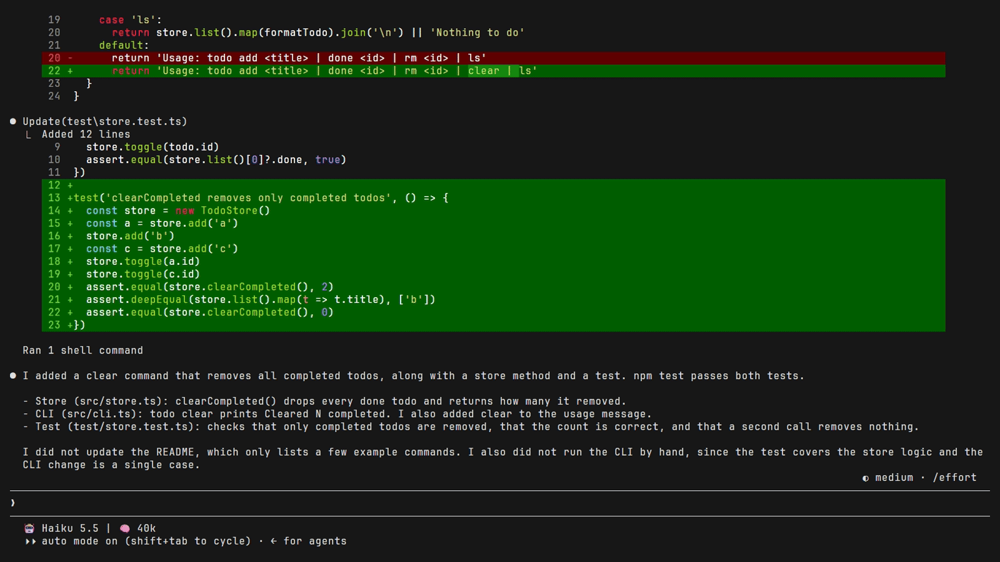
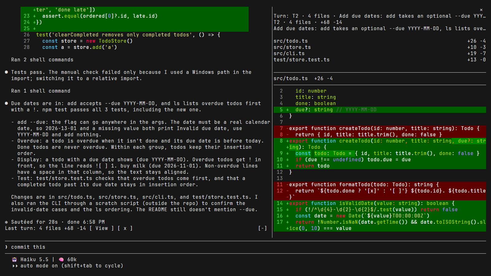

# last-turn-diff

[](https://github.com/vampy/claude-last-turn-diff/tags)
[](#install)
[](LICENSE)

**A Claude Code mod that shows what the last turn changed**: every file, one net diff each, in a pane, like the
turn diff in Codex. A file edited five times shows once, before the turn against after it, not as five patches to
step through. Inside a git repository or a Plastic SCM workspace it also shows files that shell commands, scripts
and builds changed, and earlier turns are a pick away. It works in the terminal and in the Claude Desktop Code tab.



[Install](#install) · [Use](#use) · [If the pane doesn't show](#if-the-pane-doesnt-show) ·
[What you see](#what-you-see) · [What counts as a change](#what-counts-as-a-change) ·
[What it can reach](#what-it-can-reach) · [Compared with /diff](#compared-with-diff) · [Options](#options) ·
[Notes and limitations](#notes-and-limitations) · [Develop](#develop)

## Install

Needs Claude Code 2.1.289 or later. In a Claude Code session, add this repository as a plugin marketplace, then
install the mod and start a new session:

```text
/plugin marketplace add vampy/claude-last-turn-diff
```

```text
/plugin install last-turn-diff@last-turn-diff
```

A mod runs with your permissions: [What it can reach](#what-it-can-reach) lists what this one does, and how to
check that yourself before you install it.

<details>
<summary>Update or remove</summary>

To update, run these and start a new session:

```bash
claude plugin marketplace update last-turn-diff
```

```bash
claude plugin update last-turn-diff@last-turn-diff
```

To remove it, run `claude plugin uninstall last-turn-diff@last-turn-diff`, then
`claude plugin marketplace remove last-turn-diff`.

</details>

## Use

1. Ask Claude for a change that edits files, for example "add due dates to the todos, with a test".
2. When the turn ends, the **Last turn** pane opens (turn this off with `autoOpen`), and a line above the prompt,
   the band, reads:

   ```text
   Last turn: 4 files +68 −14 [ View ] [ x ]
   ```

   View opens the pane again. x hides the band until the next turn with changes.
3. Type `/turn-diff` to open the pane, or to close it if it is on screen. It also replies with a one-line summary,
   which is all you get on mobile.
4. To see an earlier turn, pick it from the **Turn** picker at the top of the pane. `/turn-diff` and View go
   back to the last turn with changes.

In a terminal the pane docks beside the transcript in the fullscreen layout from 110 columns, and sits above the
prompt otherwise. In Desktop, click. In a terminal, press ctrl+x, then Tab, to give the keyboard to the band or the
pane: Tab moves between its buttons, Enter presses one, the arrows and Enter work the picker, and Escape gives the
keyboard back to the prompt.

## If the pane doesn't show

- **Claude Code's diff panel is in front.** In the terminal's fullscreen layout, Claude Code's own diff panel
  (`/diff`) can come up after a turn and take the pane's place. `/turn-diff` and View then say so rather than
  close the pane: type `/diff` to hide that panel, or turn it off with `"diff@builtin": false` under
  `enabledPlugins` in `~/.claude/settings.json`.
- **The turn changed no files.** A question, or a notice that a background task finished, leaves the pane and
  the band as they were.
- **The terminal is narrow.** Below 144 columns the pane doesn't open by itself: it waits until the terminal is
  wider, or until you type `/turn-diff`.
- **Desktop split view.** Desktop draws no mod UI for a session shown in the second half of a split view, though
  `/turn-diff` still answers. Show the session on its own.
- **Mobile.** There is no pane or band: `/turn-diff` replies with the summary only.
- **You just changed `~/.claude/settings.json`.** Start a new session.

## What you see

The recording at the top is a real turn in a terminal: Claude adds due dates to a small todo app, and when the turn
ends the pane opens with its four files. (Recorded with Claude Code's own diff panel turned off: see
[If the pane doesn't show](#if-the-pane-doesnt-show).)

The pane after that turn, docked beside the transcript, with the band above the prompt:



The pane in the Desktop Code tab after a turn that adds a priority field, where each hunk is an image with line
numbers, syntax colors and a Copy button:


The same turn with `selectableDiffs` on, where each hunk is numbered code you can select, removed lines framed in
red and added lines in green:


- **Header**: the turn's number, file count and line counts, the prompt's first line, a note when shell changes
  could not be read, and a line saying so when the turn was rebuilt from the transcript.
- **File rows**: one per file, with its counts and badges: `new`, `deleted`, `binary`, `too large`, or a
  line-ending change such as `CRLF→LF` (`EOL` when only the line endings moved). Pressing a row jumps to that
  file: its page always switches, and the pane scrolls to it where the surface supports that.
- **Hunks**: in a terminal, `diff` code blocks. In the Desktop Code tab, images with red and green lines, line
  numbers and syntax colors, each hunk under its `@@` line with a Copy button (see `svgDiffs`), or selectable
  numbered code blocks with removed and added lines framed (see `selectableDiffs`).
- **Pages**: a large turn is split into pages with Prev and Next.
- **Turn picker**: shown once more than one turn has changes. It lists the newest 64 turns that changed files,
  each with its prompt and the number of files it edited, and shows the last one by default.

## What counts as a change

- **Claude's edits**: every file Claude's file tools (`Edit`, `Write`, `NotebookEdit`) changed during the turn,
  under any version control or none, including those of the subagents it runs during the turn. Denied and failed
  calls are left out.
- **Shell edits**: inside the git repository or Plastic SCM workspace the session started in, files changed by
  shell commands, scripts and builds too, read from the version control's status before and after the turn. Files
  it ignores (`.gitignore`, Plastic's `ignore.conf`) don't show. A git commit during the turn still shows its
  files. See `shellEdits`.
- **One net diff per file**: the file before the turn against the file after it, so a file edited five times
  shows once, and a file changed and changed back doesn't show.
- **Not Claude Code's own files**: its scratchpad, memory and plan files are left out. See `hideClaudeFiles`.
- **Mostly not other writers**: a file only the version control's status lists, which another session or your
  editor wrote between the turn's tool calls, stays out. What lands while a call runs, or in a file Claude edited,
  counts: see [Shell edits](#shell-edits) under Notes.
- **Earlier turns**: picking one rebuilds its changes from the transcript, so the history survives `--resume` and
  `--continue`. A rebuilt turn shows only Claude's own file-tool calls of the main conversation, and usually shows
  each call's patch in turn rather than one diff per file: see [Earlier turns](#earlier-turns).

## What it can reach

A mod runs inside Claude Code with your permissions. This one:

- **Watches** turns starting and ending and Claude's tool calls, and only looks: it never blocks, changes or reruns
  a call.
- **Reads** the files a turn changes, before and after it, and, with `turnHistory` on, the conversation's
  transcript, to rebuild earlier turns.
- **Runs** only read-only `git` and `cm` commands, and only with `shellEdits` on.
- **Writes** only temporary files for `cm`'s output, and the clipboard when you press a Copy button.
- **Reads these environment variables**, to find Claude Code's temporary and config folders: `CLAUDE_CODE_TMPDIR`,
  `CLAUDE_CONFIG_DIR`, `HOME`, `TEMP`, `TMP`, `TMPDIR`, `USERPROFILE` and `XDG_RUNTIME_DIR`.
- **Sends nothing anywhere**: it makes no network requests and calls no model.

To check this yourself before you install it, run this after `/plugin marketplace add`. It lists the hooks the mod
registers, the engine calls it makes and the environment variables it reads, from the copy the marketplace fetched:

```bash
claude plugin validate ~/.claude/plugins/marketplaces/last-turn-diff
```

## Compared with /diff

Claude Code 2.1.318 has a diff panel of its own, `/diff`. It shows the uncommitted changes (`git diff HEAD`), and
its **source** picker (Current, T1, T2, …) shows one turn. On the same turns, side by side:

| | `/diff` | last-turn-diff |
| --- | --- | --- |
| Shows by default | Every uncommitted change: any turn's, and your own | The last turn's changes |
| A turn's files | Those Claude's `Edit` and `Write` calls changed | Those too, and files shell commands, scripts and builds changed |
| A file edited twice in one turn | Each call's patch added up: +2 −1 for a line added, then reworded | One net diff: +1 −0 |
| Version control | git | git, Plastic SCM or none (shell edits need git or Plastic) |

That is the last turn, which the mod records live. An earlier turn it rebuilds from the transcript has much the same
limits as `/diff`'s: Claude's own calls only, often shown call by call (see [Earlier turns](#earlier-turns)).

## Options

| Option | Default | What it does |
| --- | --- | --- |
| `autoOpen` | on | Opens the pane by itself when a turn ends with file changes. |
| `shellEdits` | on | Also shows files changed by shell commands, scripts and builds, from git or Plastic SCM status. |
| `turnHistory` | on | Lists the conversation's turns in the pane, so an earlier one can be picked and rebuilt. |
| `hideClaudeFiles` | on | Leaves out Claude Code's own temporary, memory and plan files. |
| `showMemoryAndPlans` | off | With `hideClaudeFiles` on, shows Claude's memory and plan edits again. |
| `svgDiffs` | on | In the Desktop Code tab, draws the hunks as images with line numbers and syntax colors. |
| `selectableDiffs` | off | In the Desktop Code tab, draws the hunks as numbered code blocks you can select, removed and added lines marked and framed. |

To change them in a terminal, use `/config`. The Desktop Code tab has no `/config`: add this to
`~/.claude/settings.json`, keeping only the options you change, and start a new session. Project settings are not
read for plugin options. The full id works too, `last-turn-diff@last-turn-diff` (`last-turn-diff@inline` for a copy loaded
from a folder); it is the one `claude plugin configure` writes.

```json
"pluginConfigs": {
  "last-turn-diff": {
    "options": {
      "autoOpen": false,
      "shellEdits": false,
      "turnHistory": false,
      "showMemoryAndPlans": true,
      "selectableDiffs": true
    }
  }
}
```

More on each:

- `autoOpen`: like any pane opened unasked, it is shown only in a terminal at least 144 columns wide (110 once you
  have opened it yourself, until you close it by hand); below that it waits, and `/turn-diff` shows it.
- `shellEdits`: off, the mod runs no process at all and sees only `Edit`, `Write` and `NotebookEdit` calls. Turn it
  off if a status is slow in your repository or workspace: in a large Plastic workspace each `cm status` takes a few
  seconds (2.3 s on a big Unreal project), and each base revision fetched from a cloud repository about a second.
- `turnHistory`: off, the mod never reads the transcript. The pane shows only the last turn with changes the mod
  recorded, numbered from when it loaded (slash commands don't count), and after a restart or `--resume` nothing
  until a turn ends. Turn it off if reading the transcript after each turn is slow in a long session.
- `hideClaudeFiles` leaves these out, live and in rebuilt turns:
  - its temporary folder, such as the scratchpad where it writes notes and commit messages: `claude` under
    `CLAUDE_CODE_TMPDIR`, or else under each of `TEMP`, `TMP` and `TMPDIR` the environment names, and `/tmp`;
  - its memory and plans: `projects`, `agent-memory` and `plans` in its config folder, `CLAUDE_CONFIG_DIR` or else
    `.claude` in the home folder (`HOME` or `USERPROFILE`). The rest of that folder (settings, `CLAUDE.md`, skills)
    still shows, and so does memory or a plan a setting moved elsewhere.

  Each folder is matched under its parent as spelled and where that lands (a symlink or junction's target; macOS's
  `/private/var`). On Windows a parent spelled from `/` (such as `/tmp`) is skipped: it would land on the session's
  drive. A turn that changed only such files counts as changing nothing. A session run inside one of those folders
  still sees the files under its own cwd.
- `showMemoryAndPlans`: its temporary files stay hidden. It is listed in `/config` only while `hideClaudeFiles` is
  on: off, nothing is hidden.
- `svgDiffs`: Desktop (app 4.23118) draws a `Code` element's `format: 'diff'` as plain `diff` text, with no line
  numbers, line backgrounds or language colors, so the mod draws them itself. An image's text can't be selected, so
  each hunk has a Copy button that puts its lines as they are now (unchanged and added, no markers) on the
  clipboard. Turn it off if the images ever draw wrong.
- `selectableDiffs`: Desktop draws numbered code (a `Code` with a `startLine`) with its own highlighter, theme and
  line numbers, and that text can be selected, unlike plain `diff` text and images. So each hunk shows under its
  `@@` line as runs of numbered code: unchanged lines numbered as they are now, removed lines as they were, marked
  `-` in a red frame, and added lines marked `+` in a green one. A mod can't put the marks in Desktop's gutter or
  shade the lines, so the marks are part of the code and a copy takes them too. Each block has Desktop's own copy
  button. It takes precedence over `svgDiffs`.

  With both off, Desktop shows the plain `diff` code blocks the terminal gets.

## Notes and limitations

### Shell edits

- Shell changes are seen only inside the git repository or Plastic workspace the session started in, and not in
  files it ignores (`.gitignore`, Plastic's `ignore.conf`). Outside both, only `Edit`, `Write` and `NotebookEdit`
  calls are seen.
- Another session's writes, or your editor's, count as the turn's when they land while one of the turn's calls
  runs (a long build, a background server, a question or a permission prompt waiting for you: a call is timed from
  before its prompt, and one you refuse still counts), when they land in a file the turn's `Edit`, `Write` or
  `NotebookEdit` calls changed, or as a deletion or a dated copy in a folder whose entries one of the turn's calls
  changed. The other way round, a change the turn made through the shell drops out when something else writes the
  file later in the turn, when a process a command left running (`Start-Process`, `&`) writes after the command
  returned, when a deletion or dated copy shares its folder with something added or removed later, when a dated copy
  replaces a file already there, or when the file system's clock is more than 2 s off (a network share). A background
  command still writing in a later turn shows there only what lands during one of that turn's calls.
- Snapshot caps: content is recorded for files dirty at turn start up to 16 MiB in all; past that (or past
  2 MiB, or binary) a file is recorded by size and mtime and shows without hunks if those change. Past
  1,000 dirty files the rest are left out. At turn end at most 1,000 newly listed files are shown, with a
  note for the rest.
- A hot reload while the turn-start status is still running loses shell changes for that turn.
- A tool call waits for the turn-start status at most 5 s (Claude's own `Edit`, `Write` and `NotebookEdit` don't
  wait at all, and show in full however slow it is). Past that the call runs beside the status, so what it writes
  through the shell may not show. A turn that ends before the status does shows no shell changes, with a note.
- Plastic: a turn that runs `cm update`, `switch` or `merge`, or moves the loaded changeset (a check-in), shows
  only Claude's own edits and the files dirty at turn start, with a note. One started in the background in an
  earlier turn and still running at the next turn's start is not detected: that turn's read-only `cm status` runs
  beside it.
- Plastic: moves made by a shell `mv` (not `cm mv`) show as a deleted file and a new one: the mod leaves out
  `--localmoved`, a slow similarity search.
- Plastic: Gluon (partial) workspaces are neither handled nor tested.

### Earlier turns

- Only the last turn is recorded live. Older turns are rebuilt from the transcript when picked, and show only
  `Edit`, `Write` and `NotebookEdit` calls of the main conversation: no shell changes, no subagent edits, and no
  line-ending changes (the tools hand back `originalFile` with LF). A turn that changed a file and changed it back
  shows nothing, unless the transcript kept no copy of the file: then both calls' patches show.
- Claude Code doesn't keep every `Edit`'s and `Write`'s `originalFile`. A headless (`-p`) run strips them all; a
  resumed transcript keeps them only for files under about 10 KB; and, as 2.1.292's code reads, a session strips the
  bulk of all but about its newest 200 messages. Without it, a rebuilt file shows each call's own patch in turn, with
  its own line numbers, so older turns usually show that way.
- The picker reads only the newest 4,096 transcript entries, and a compaction drops the turns before it. Turns
  number from the oldest one left, so in a long session the numbers shift as old turns drop out. It lists only the
  newest 64 turns, the most a `Select` takes. A `/clear` or a resume inside a session starts a new list and clears
  the last turn.
- An older turn's file count is the number of files its calls edited, so it can differ from the files its rebuilt
  diff shows, for example when a turn edits a file back to how it was. A turn that changed files only through shell
  commands or subagents is listed while it is the last turn with changes, and drops out of the list after the next one.
- A turn with no prompt row in the transcript (a continuation, a message from another session) is recorded live
  as the turn after the one before it. Once rebuilt, its calls count toward the turn before it. A prompt with no text
  (an image alone) can't be told from a continuation: a continuation without changes right after such prompts can
  take one's place and give the turn shown the wrong number.

### Recording

- A background subagent that edits after the main turn ended is not recorded, or lands in the next turn.
- The before-content is read when the tool call starts, before any permission prompt. If you change the
  file yourself while the prompt is up, your change shows in the diff too.

### Large and binary files

- Files are read as UTF-8 text. A file holding a NUL byte shows as `binary`, with no hunks: UTF-16 files
  do too.
- Files over 2 MiB show as "too large to diff", with counts from the tools' `structuredPatch` where it has
  any.
- Past 2M LCS cells, a file's changed middle (from its first changed line to its last) shows as one delete block and
  one insert block when it has more than 4,000 changed lines (added and removed: a moved section counts twice), or
  when its lines repeat so much that the diff passes 20M steps. Each file shows at most about 60,000 characters of
  diff, and the rest is counted in a note.

### Claude Code's diff panel

- In the terminal's fullscreen layout, Claude Code 2.1.318's own diff panel (`/diff`) can come up after a turn and
  take the dock's place. `$.ui.panes()` still calls the Last turn pane shown, but nothing draws it, and no open
  brings it back: only `/diff` hiding the panel does. So the mod counts the pane as on screen only once it has drawn
  since it opened or its turn changed. Shown but not drawn, `/turn-diff` keeps it open and says why, and View shows a
  toast. A pane that drew before the panel came up (a `/diff` typed later) still counts as on screen: the first
  `/turn-diff` closes it unseen, and the next one opens it and says where it is.

### Desktop

- Only `selectableDiffs`' numbered code can be selected; plain `diff` code blocks, other text and images can't.
  Long lines wrap, and nothing scrolls inside a pane on its own. Desktop refuses a draw past 2,000 elements or
  262,144 characters. Each code block holds at most 10,000 characters and each page about 90,000; with
  `selectableDiffs` each file draws at most 600 runs and `@@` lines, and each page about as many (the rest counted
  in a note); with `svgDiffs` each file draws at most about 150,000 characters of SVG (roughly 800 to 2,000 lines,
  the rest counted in a note) and each page about 160,000. A turn touching several hundred files could still go
  past the limit.
- With `svgDiffs`, the colors come from a small lexer in `hooks/svg.ts` (comments, strings, numbers, one shared
  keyword list), not from Desktop's highlighter or theme, so they are approximate. Multi-line strings aren't
  tracked. Wide characters (CJK, emoji) can push a row past its wrap width. The image is laid out for the pane's
  width when drawn, and scales down if the pane gets narrower. Selectable text would need interactive `Svg`s, each
  a sandboxed frame, but Desktop rebuilds the pane on every redraw, a scroll included, and every frame flashes white
  as it reloads. A Copy takes the whole hunk, including lines past the drawing's cap; a line cut at 2,000
  characters for display is copied cut.

## How it works

How the mod records a turn, rebuilds earlier ones and reads shell edits from git and Plastic status:
[docs/how-it-works.md](docs/how-it-works.md).

## Develop

From the mod's folder:

```bash
claude plugin validate .
```

```bash
claude plugin test .
```

`tsc -p .` type-checks once the engine has loaded the mod and written `.claude-plugin/types/` (ignored by
git; the engine rewrites it on every load).

To run a clone instead of the installed copy, uninstall that, then start `claude --plugin-dir .` for one
session, or load it in every session, the Desktop Code tab included, from the `env` block of
`~/.claude/settings.json` (on Windows, double the backslashes in the path). The second line reloads the mod
when its files change:

```json
"CLAUDE_CODE_PLUGIN_DIRS": "/path/to/claude-last-turn-diff",
"CLAUDE_CODE_PLUGIN_DIR_WATCH": "1"
```

### Releasing

Bump `version` in `.claude-plugin/plugin.json`, commit and push, then tag the commit
`last-turn-diff--v<version>` and push the tag:

```bash
claude plugin tag --push
```

Installs follow the default branch, so users get the new version on their next update.
